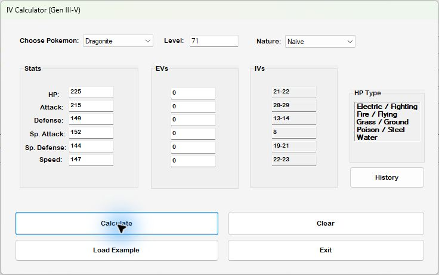

# Pokémon IV Calculator

 

**Understand possible IVs and Hidden Power types from your Pokémon's stats.**

[Releases](https://github.com/twbdavis/Pokemon-IV-Calculator-Gen-IIItoV/releases) · [Build and troubleshooting](docs/development.md) · [Report a bug](https://github.com/twbdavis/Pokemon-IV-Calculator-Gen-IIItoV/issues/new/choose)

A Windows desktop calculator using the Generation III–V stat and Hidden Power
formulas. Enter species, level, nature, observed stats, and EVs to calculate the
possible IV range for each stat. Save calculations and revisit them in History.

- IV ranges for all six stats and possible Hidden Power types.
- Bundled examples to learn the workflow without entering every field.
- Pokémon and nature data initialized locally on first launch.
- Calculation history saved in your Windows user-data directory.

## Run the calculator

Requires Windows, **.NET Framework 4.8**, and **SQL Server Express LocalDB** with
the `(LocalDB)\MSSQLLocalDB` instance available.

When available, extract the ZIP from [Releases](https://github.com/twbdavis/Pokemon-IV-Calculator-Gen-IIItoV/releases)
and run **IV_Calculator.exe**. The ZIP does not install LocalDB. If no package is
listed, use [Build from source](docs/development.md).

## First calculation

Choose **Load Example**, inspect the populated level, nature, stats, and EVs,
then choose **Calculate**. A low-level Pokémon may have several possible IVs;
a range reflects that uncertainty.

For a reproducible HP example, Bulbasaur at level 5 with 20 HP and 0 HP EVs
has an HP IV range of **10–29** in the implemented formula. Other stats and nature
must be supplied to calculate the remaining ranges.

## Data and upgrades

New installations store data at **%LOCALAPPDATA%\PokemonIVCalculator**. The
database name is unique to that directory. Startup never deletes another database
to resolve a naming conflict. The optional `IV_CALCULATOR_DATA_DIR` environment
variable selects a separate directory for testing.

Older builds saved history relative to the executable or project. To retain it,
close the app and copy your old CalculationHistory.xml into the new data directory
before saving new calculations. Preserve a backup first; old databases are not
automatically overwritten or deleted.

## Scope and status

A personal fan project. The current data has one base-stat record per species;
there is no per-game or alternate-form selector. Verify the base stats for the game
and form you are using. The calculator reports Hidden Power types, not power.
Unknown EVs or incorrect observed stats can make a result ambiguous or impossible.

Pokémon names and related marks belong to their respective owners. This project
is unaffiliated with Nintendo, Game Freak, or The Pokémon Company.

## Contribute

C# · Windows Forms · .NET Framework 4.8 · SQL Server LocalDB

[Contributing](CONTRIBUTING.md) · [Security](SECURITY.md) · [Development](docs/development.md)

## License

[MIT](LICENSE) © 2026 Thomas Davis. Third-party names and marks are not relicensed.
